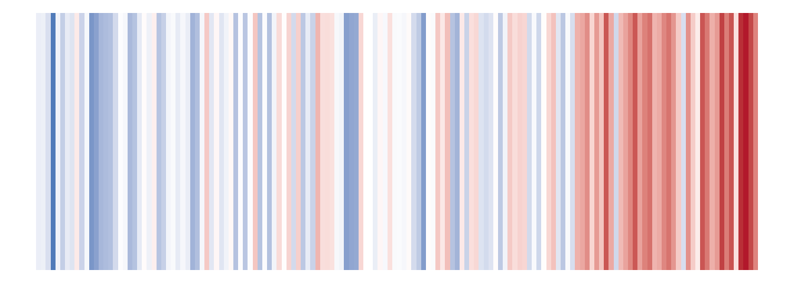

```{r}
#| label: setup
if (!require(pacman)) install.packages("pacman")
p_load(tidyverse, scales)
```

```{r}
#| label: load-data
#| cache: true
#| cache.extra: !expr file.mtime("data/weather_karlsruhe.csv")
Sys.sleep(5) # stand-in for a slow step (a download, a big file, a model)

yearly <- read_csv("data/weather_karlsruhe.csv") |>
  mutate(year = year(date)) |>
  group_by(year) |>
  summarize(
    temp_mean = mean(temp_mean, na.rm = TRUE),
    hot_days = sum(temp_max >= 30, na.rm = TRUE),
    frost_days = sum(temp_min < 0, na.rm = TRUE),
    n_days = n()
  ) |>
  filter(n_days >= 360)
```

```{r}
#| label: key-numbers
reference_period <- 1961:1990
recent_period <- 1996:2025

period_means <- yearly |>
  mutate(
    period = case_when(
      year %in% reference_period ~ "reference",
      year %in% recent_period ~ "recent"
    )
  ) |>
  filter(!is.na(period)) |>
  group_by(period) |>
  summarize(
    temp_mean = mean(temp_mean),
    hot_days = mean(hot_days),
    frost_days = mean(frost_days)
  ) |>
  pivot_wider(names_from = period, values_from = c(temp_mean, hot_days, frost_days))

warming <- period_means |>
  mutate(diff = temp_mean_recent - temp_mean_reference) |>
  pull(diff)

hot_days_reference <- period_means |>
  pull(hot_days_reference)

hot_days_recent <- period_means |>
  pull(hot_days_recent)

warmest_year <- yearly |>
  slice_max(temp_mean) |>
  pull(year)
```

## Introduction

Karlsruhe is one of the warmest cities in Germany. This report uses daily observations of the
Deutscher Wetterdienst [@dwd2026] to show how its climate changed since 1876. All analyses were
done in R with the tidyverse [@wickham2023].

## Data

Two stations: Karlsruhe (1876–2008) and its successor Rheinstetten (since 2008). Years with
fewer than 360 observed days are excluded, leaving `r nrow(yearly)` years.

## Results

### Temperature

The mean temperature of the last 30 years (`r min(recent_period)`–`r max(recent_period)`) is
**`r round(warming, 1)` °C** higher than in the reference period
`r min(reference_period)`–`r max(reference_period)`. The warmest year on record is
`r warmest_year`. @fig-anomaly shows the deviation of every year from the reference mean,
@fig-stripes the same data as "warming stripes" [@hawkins2018].

```{r}
#| label: fig-anomaly
#| fig-cap: "Annual mean temperature in Karlsruhe, deviation from the 1961–1990 mean."
reference_temp <- yearly |>
  filter(year %in% reference_period) |>
  summarize(reference = mean(temp_mean)) |>
  pull(reference)

yearly |>
  mutate(anomaly = temp_mean - reference_temp) |>
  ggplot(aes(x = year, y = anomaly, fill = anomaly)) +
  geom_col() +
  scale_fill_gradient2(low = "#2166AC", mid = "white", high = "#B2182B", guide = "none") +
  scale_y_continuous(labels = label_number(suffix = " °C", style_positive = "plus")) +
  labs(
    x = NULL,
    y = "Deviation"
  ) +
  theme_minimal()
```

{#fig-stripes width=80%}

### Hot and frost days

A hot day (*heißer Tag*) has a maximum of at least 30 °C, a frost day a minimum below 0 °C.
@tbl-days compares both periods.

```{r}
#| label: tbl-days
#| tbl-cap: "Average number of days per year."
period_means |>
  pivot_longer(
    everything(),
    names_to = c("measure", "period"),
    names_pattern = "(.*)_(reference|recent)"
  ) |>
  pivot_wider(names_from = period, values_from = value) |>
  filter(measure != "temp_mean") |>
  mutate(measure = recode_values(measure, "hot_days" ~ "Hot days", "frost_days" ~ "Frost days")) |>
  knitr::kable(
    col.names = c("", "1961–1990", "1996–2025"),
    digits = 1
  )
```

Hot days went from about `r round(hot_days_reference)` to `r round(hot_days_recent)` per year.

## Method

The anomaly of year $t$ is its mean temperature minus the mean of the reference period $R$
(30 years):

$$
\Delta T_t = \bar{T}_t - \frac{1}{30} \sum_{s \in R} \bar{T}_s
$$

## References

::: {#refs}
:::
